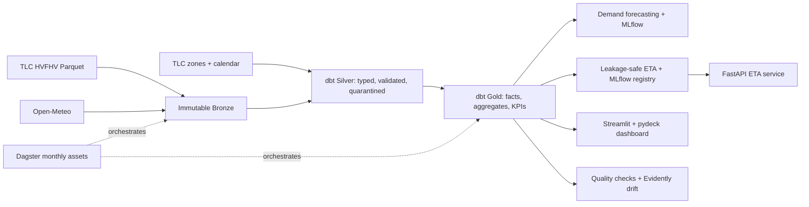

# NYC Mobility Analytics

Local-first analytics and machine-learning platform for NYC TLC High-Volume For-Hire Vehicle (HVFHV) trip data. It ingests immutable monthly Parquet files, builds a DuckDB/dbt warehouse, trains leakage-safe demand and ETA models, and exposes results through Dagster, FastAPI, Streamlit, and local monitoring.

## What it answers

- Where and when demand is highest for driver positioning.
- What a pre-trip ETA is likely to be from zone, time, weather, and historical route behavior.
- How wait times, sharing, and approximate driver/platform economics vary by zone and hour.
- Whether data quality, model error, or feature distributions need attention.

## Architecture



See [architecture.md](docs/architecture.md) for the operational flow and data contracts.

## January 2024 results

These are descriptive, one-month results—not causal claims or production guarantees.

| Area | Result |
|---|---:|
| Clean Gold trips | 19,658,947 |
| Quarantine rate | 0.025% (4,983 rows) |
| Demand champion | Seasonal-naive, 13.42% WAPE on final holdout |
| ETA LightGBM MAE | 224.47 seconds (vs. 264.63 seconds historical-OD baseline) |
| ETA within 5 minutes | 76.65% |

More context and limitations are in [findings.md](docs/findings.md) and [modeling.md](docs/modeling.md).

## Quick start

Requires Python 3.11 and [uv](https://docs.astral.sh/uv/). Docker is optional for serving.

```powershell
uv sync --all-extras
uv run pre-commit install
make check

# First monthly partition
make download-ref
make download-tlc
make download-weather
make build-calendar
make dbt-build
```

The default month is `2024-01`; add months deliberately in `config/settings.yaml`. Bronze files and generated warehouse artifacts are ignored by Git.

## Run the platform

| Task | Command |
|---|---|
| Dagster UI | `make dagster-ui` |
| Materialize January partition | `make dagster-partition` |
| Train demand / ETA | `make train-demand` / `make train-eta` |
| Run ETA API | `make api` |
| Build/run API container | `make docker-api` |
| Start dashboard | `make dashboard` |
| Build deployable dashboard snapshot | `make dashboard-snapshot` |
| Run data quality | `make quality` |
| Run drift report | `make drift` |

The API requires a locally registered MLflow ETA model and read-only warehouse. The dashboard reads Gold marts directly from DuckDB.

For Streamlit Cloud, generate a small dashboard snapshot and configure its approved URL/checksum in app Secrets; see [deployment.md](docs/deployment.md). Raw TLC data and the full local warehouse are never deployed from Git.

## Quality and CI

GitHub Actions installs all optional dependencies, checks Ruff formatting/linting, runs pytest, parses the dbt project, and builds the API Docker image. CI does not download or commit TLC data; run `make dbt-build` locally after ingestion.

`make quality` writes a local quality report and alerts on a reject rate above 2%, duplicate trip IDs, invalid core facts, or an ETA MAE regression above 15%. Drift reports require two distinct completed months and use Evidently on deterministic samples.

## Optional stretch experiments

Phase 12 adds an explicitly synthetic Kolkata portability fixture, a local JSONL replay utility, and a descriptive congestion-fee comparison tool. They are isolated from the NYC production-style pipeline and make no causal or real-Kolkata claims. See [stretch.md](docs/stretch.md).

## Data sources and limitations

- NYC TLC HVFHV [Trip Record Data](https://www.nyc.gov/site/tlc/about/tlc-trip-record-data.page)
- [TLC taxi-zone lookup and boundaries](https://www.nyc.gov/site/tlc/about/tlc/taxi-and-for-hire-vehicle-fhv-related-information.page)
- [Open-Meteo Historical Weather API](https://open-meteo.com/en/docs/historical-weather-api)

Locations are TLC zone IDs, not GPS points, and there are no driver or rider identities. Zone centroids are only display aids. The ETA service never uses actual post-trip miles; it uses historical OD aggregates from completed hours only. Approximate platform take excludes costs and adjustments, so it is not profit. See [data_dictionary.md](docs/data_dictionary.md) and [runbook.md](docs/runbook.md).
