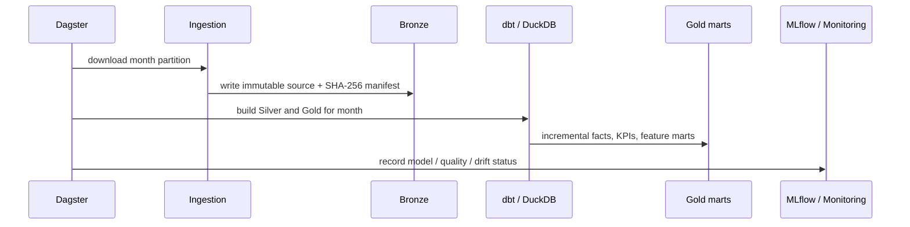

# Architecture

## Monthly execution path

## Contracts

- Bronze files are untouched originals under `data/bronze/hvfhv/year=YYYY/month=MM/`.
- Silver retains valid trips and quarantines every failed row with a reason.
- Gold geographic marts exclude TLC zone IDs 264/265; `fct_trips` retains them with an explicit flag.
- ETA serving reads only completed historical hours before the request timestamp. Actual trip miles are excluded from serving inputs.
- Runtime artifacts—warehouse, MLflow runs, model files, quality, and drift reports—are local and Git-ignored.

## Local deployment boundaries

The API Docker image mounts the local MLflow registry and DuckDB warehouse read-only. Dagster and Streamlit run directly on the local machine. No cloud services, secrets, or external notification channels are required for the current MVP.
