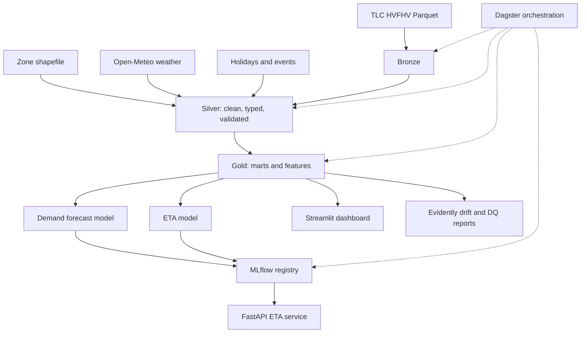

# NYC Mobility Analytics: Geospatial Ride-Hailing Demand and ETA Platform

A production-style data analytics project built on real NYC ride-hailing trip data (TLC High-Volume For-Hire Vehicle records). It covers ingestion, warehousing, geospatial analysis, machine learning, serving, monitoring, and documentation.

> **Note on history:** This project began as a Kolkata delivery-optimization idea. No public real-trip dataset exists for Kolkata, so the project moved to New York City, where large, real, public trip data exists. An optional stretch phase (Phase 12) revisits Kolkata with simulated data to show the pipeline transfers.

---

## 1. Project description

### 1.1 One-line summary
Build an end-to-end analytics platform that ingests NYC ride-hailing trips, models demand by zone and hour, predicts trip duration (ETA), evaluates operational efficiency, and serves results through an API and interactive dashboard.

### 1.2 Business problem
Imagine you are the analytics team at a ride-hailing or delivery company operating in NYC. Leadership wants answers to:

1. **Where and when will demand be highest**, so drivers can be pre-positioned?
2. **How long will a trip take**, so customers get accurate ETAs?
3. **Which zones, times, and trip types are most or least profitable** for drivers and the platform?
4. **How do weather, holidays, bridges/tunnels, and events change demand and trip times?**
5. **Is our data and model still trustworthy over time?** (quality checks and drift monitoring)

### 1.3 Deliverables
- A reproducible, orchestrated data pipeline (bronze, silver, gold layers)
- A tested dbt project with documentation and lineage
- Two ML models: **demand forecast per zone-hour** and **trip duration (ETA) prediction**
- A FastAPI endpoint serving ETA predictions
- A Streamlit dashboard with maps, KPIs, and model diagnostics
- CI/CD, data quality tests, drift monitoring, and a full README with architecture diagram
- Written findings (insights report) with honest limitations

### 1.4 Skills demonstrated
Data engineering (pipelines, incremental loads, orchestration), analytics engineering (dbt, modeling, testing), geospatial analysis, time-series forecasting, supervised ML with leakage control, MLOps basics (tracking, registry, drift), API development, dashboarding, and software practices (CI, tests, Docker).

### 1.5 Scope

**In scope**
- 6 to 12 months of HVFHV trips (start with 1 month, scale up)
- Zone-level analysis (TLC taxi zones), optionally re-indexed to H3 hexagons
- Weather, holiday, and event enrichment
- Batch (not real-time) processing

**Out of scope (initially)**
- Real-time streaming
- Driver-level or rider-level identification (data does not contain it)
- Exact GPS routes (data is zone-level only)
- Cloud deployment (optional stretch)

---

## 2. Data sources

> Always verify current URLs, schemas, and licenses on the official pages before starting. Formats and hosting change.

| Data | Source | Notes |
|---|---|---|
| **HVFHV trip records** | NYC TLC Trip Record Data page (monthly Parquet files) | Core dataset. Uber, Lyft, and others. Hundreds of millions of rows across years. |
| **Taxi zone lookup** | TLC site (`taxi_zone_lookup.csv`) | Maps `LocationID` to borough, zone name, service zone. |
| **Taxi zone geometry** | TLC site (shapefile, or GeoJSON via NYC Open Data) | 263 zones; needed for maps and spatial features. |
| **Weather** | Open-Meteo Historical Weather API (free) | Hourly temperature, precipitation, snowfall, wind for NYC (about 40.71 N, 74.01 W). |
| **Holidays** | Python `holidays` library (US / New York) | Plus a manual event calendar (marathon, parades, UN General Assembly week, big concerts or games). |
| **Road network (optional)** | OpenStreetMap via OSMnx | For route-distance comparisons and bridge/tunnel analysis. |

### 2.1 Key HVFHV columns (verify against current data dictionary)
- `hvfhs_license_num`: company code (Uber, Lyft, etc.)
- `dispatching_base_num`, `originating_base_num`
- `request_datetime`, `on_scene_datetime`, `pickup_datetime`, `dropoff_datetime`
- `PULocationID`, `DOLocationID`: pickup and dropoff zone IDs
- `trip_miles`, `trip_time` (seconds)
- `base_passenger_fare`, `tolls`, `bcf`, `sales_tax`, `congestion_surcharge`, `airport_fee`, `tips`, `driver_pay`
- `shared_request_flag`, `shared_match_flag`, `wav_request_flag`, `wav_match_flag`, `access_a_ride_flag`

Newer files may add columns (for example, a congestion pricing fee introduced in 2025). Your schema handling must tolerate this (see Risks).

### 2.2 Derived quantities
- **Wait time** = `pickup_datetime` minus `request_datetime`
- **Driver arrival delay** = `on_scene_datetime` minus `request_datetime`
- **Trip duration** = `dropoff_datetime` minus `pickup_datetime` (validate against `trip_time`)
- **Average speed** = `trip_miles` / (`trip_time` / 3600)
- **Driver pay per minute / per mile**
- **Platform take** = fare minus driver pay (approximation; document assumptions)

---

## 3. Tech stack

### 3.1 Summary

| Layer | Tool | Purpose |
|---|---|---|
| Language | Python 3.11+, SQL | Core development |
| Storage format | Parquet | Columnar, compressed, partitioned files |
| Query engine | **DuckDB** (with spatial extension) | Laptop-scale analytics over Parquet, no server |
| Transformations | **dbt-core + dbt-duckdb** | Modular SQL, tests, docs, lineage |
| Orchestration | **Dagster** (Airflow is an alternative) | Scheduling, retries, backfills, asset lineage |
| Dataframes | Polars (and pandas where needed) | Fast feature engineering |
| Geospatial | GeoPandas, Shapely, **H3**, pyproj | Polygons, spatial joins, hex grids |
| Forecasting | statsforecast, Prophet (optional), LightGBM | Baseline and ML demand models |
| ML | LightGBM, scikit-learn, Optuna, SHAP | ETA model, tuning, explainability |
| Tracking / registry | **MLflow** | Experiments, model versions |
| Data quality | dbt tests + Great Expectations or Soda | Contracts and validation |
| Drift monitoring | Evidently | Data and model drift reports |
| API | **FastAPI + Pydantic + Uvicorn** | ETA prediction service |
| Dashboard | **Streamlit + pydeck** (or Kepler.gl) | Maps and KPIs |
| Packaging | Docker, docker-compose | Reproducible environment |
| CI/CD | GitHub Actions | Lint, test, dbt build |
| Code quality | Ruff, pytest, pre-commit, mypy (optional) | Consistency and correctness |
| Docs | Markdown, dbt docs, Mermaid diagrams | Architecture and lineage |

### 3.2 Hardware and cost
- **RAM:** 16 GB is comfortable for 6 to 12 months of data. With 8 GB, use 1 to 3 months or sample.
- **Disk:** budget 30 to 60 GB for a year of data plus intermediate layers.
- **Cost:** zero. All tools are open source; no cloud required.

### 3.3 Optional cloud upgrade (stretch)
Parquet on S3/GCS, BigQuery or Snowflake instead of DuckDB, Dagster on a small VM, Terraform for infrastructure. Do this only after the local version works end to end.

---

## 4. Architecture

### 4.1 Data flow

```
TLC Parquet files + Zone shapefile + Weather API + Holidays/Events
                          |
                          v
                 BRONZE (raw, unchanged)
        data/bronze/hvfhv/year=YYYY/month=MM/*.parquet
                          |
                          v
                 SILVER (cleaned, typed, validated)
        - schema normalization, dedupe, bad-row quarantine
        - timestamp and duration validation
        - zone join (borough, zone name, geometry centroid)
        - H3 cell mapping, weather and holiday join
                          |
                          v
                 GOLD (analytics-ready marts)
        - fct_trips
        - agg_zone_hour_demand
        - features_eta
        - features_demand
        - kpi_zone_daily, kpi_driver_economics
                          |
              +-----------+-----------+
              v                       v
        ML training              Dashboard queries
   (demand + ETA, MLflow)        (Streamlit + pydeck)
              |
              v
   Model registry --> FastAPI ETA service
              |
              v
   Evidently drift reports + data quality alerts
```

### 4.2 Mermaid version (paste into README)



### 4.3 Design principles
- **Immutable bronze:** never edit raw files.
- **Idempotent, incremental loads:** re-running a month gives the same result; no full reloads.
- **Time-aware splits:** train on the past, validate on the future, never shuffle across time.
- **Point-in-time features:** any feature must be available at prediction time (no leakage).
- **Everything reproducible:** pinned dependencies, seeds, Docker, config in files not code.

---

## 5. Repository structure

```
nyc-mobility-analytics/
├── README.md
├── plan.md
├── pyproject.toml              # dependencies and tool config
├── docker-compose.yml
├── Dockerfile
├── Makefile                    # shortcuts: make ingest, make dbt, make train
├── .pre-commit-config.yaml
├── .github/workflows/ci.yml
├── config/
│   ├── settings.yaml           # months to load, paths, thresholds
│   └── events.csv              # manual event calendar
├── data/                       # gitignored
│   ├── bronze/
│   ├── silver/
│   ├── gold/
│   └── reference/              # zones, shapefiles
├── ingestion/
│   ├── download_tlc.py
│   ├── download_weather.py
│   └── download_reference.py
├── dbt_project/
│   ├── dbt_project.yml
│   ├── models/
│   │   ├── staging/            # stg_hvfhv, stg_zones, stg_weather
│   │   ├── silver/             # cleaned trips, quarantine
│   │   └── gold/               # facts, aggregates, features, KPIs
│   ├── tests/
│   ├── macros/
│   └── seeds/
├── orchestration/
│   └── dagster_project/        # assets, schedules, sensors
├── ml/
│   ├── features.py
│   ├── train_eta.py
│   ├── train_demand.py
│   ├── evaluate.py
│   └── notebooks/              # exploration only
├── api/
│   ├── main.py
│   ├── schemas.py
│   └── model_loader.py
├── dashboard/
│   └── app.py
├── monitoring/
│   ├── drift_report.py
│   └── dq_checks.py
├── tests/
│   ├── unit/
│   └── integration/
└── docs/
    ├── architecture.md
    ├── data_dictionary.md
    ├── runbook.md
    └── findings.md
```

---

## 6. Data model

### 6.1 Silver layer
**`silver_trips`** (cleaned): one row per valid trip.
- Typed timestamps, non-null zone IDs, validated durations and distances
- Deduplicated on a composite key (license, request time, pickup time, zones, fare)
- Adds: `pickup_borough`, `dropoff_borough`, `pickup_h3`, `dropoff_h3`, `wait_seconds`, `trip_seconds`, `avg_mph`

**`silver_trips_quarantine`**: rows failing rules, with a `reject_reason` column. Never silently drop data.

**Cleaning rules (starting thresholds; tune from data):**
- `dropoff_datetime` > `pickup_datetime`
- Trip duration between about 1 minute and 6 hours
- Trip miles > 0 and below a sane cap (for example, 200)
- Average speed below a plausible cap (for example, 80 mph)
- Pickup/dropoff zone IDs exist in the zone lookup (note: some IDs like 264/265 mean unknown/outside NYC; decide handling explicitly)
- Timestamps fall within the file's expected month (with tolerance for boundary trips)
- Fares and driver pay not negative

### 6.2 Gold layer

| Model | Grain | Purpose |
|---|---|---|
| `fct_trips` | 1 row per trip | Clean fact table with all dimensions joined |
| `dim_zone` | 1 row per zone | Borough, name, centroid, area |
| `dim_date_hour` | 1 row per hour | Weather, holiday, event flags |
| `agg_zone_hour_demand` | zone x hour | Trip counts, avg wait, avg fare, share shared rides |
| `features_eta` | 1 row per trip | ETA training features |
| `features_demand` | zone x hour | Lags, rolling means, calendar and weather features |
| `kpi_zone_daily` | zone x day | Trips, avg trip time, wait time, late rate |
| `kpi_driver_economics` | zone x hour | Pay per mile/min, take rate, tips |
| `agg_od_matrix` | origin x dest x hour-bucket | Flow analysis, bridge/tunnel corridors |

### 6.3 Features

**ETA model (target: `trip_seconds`)**
- `trip_miles` (note: available at request time only as an estimate; see leakage note below)
- Pickup zone, dropoff zone, borough pair
- Hour, day of week, month, weekend, holiday, event flag
- Precipitation, snowfall, temperature, wind
- Cross-borough flag, airport flag, bridge/tunnel corridor flag
- Historical average speed for the origin-destination pair or zone (computed from prior data only)
- Historical median duration for the same OD pair and hour-of-week (past data only)

**Leakage warning for ETA:** at prediction time you know pickup zone, dropoff zone, time, and weather, but you do **not** know actual `trip_miles`. Two honest options: (a) use a zone-pair typical distance derived from historical trips or the road network instead of actual miles, or (b) explicitly document that the model uses actual miles and is therefore a "post-hoc duration model," not a true pre-trip ETA. Prefer (a) for the serving model.

**Demand model (target: trips per zone-hour)**
- Lags: same hour yesterday, same hour last week, previous 1 to 3 hours
- Rolling means (past only)
- Calendar: hour, weekday, holiday, event
- Weather forecast or observed weather (document which)
- Zone attributes: borough, airport flag, static area characteristics

---

## 7. Workflow: phase by phase

Estimated total: about 8 to 10 weeks part-time. A reduced version (Phases 0 to 6 with one month of data, plus a simple dashboard) fits in 3 to 4 weeks.

### Phase 0: Setup (Days 1 to 2)
**Tasks**
- Create the GitHub repo, folder structure, and `pyproject.toml`
- Install Python 3.11+, Git, Docker; create a virtual environment
- Install core packages: `duckdb dbt-duckdb dagster dagster-webserver geopandas h3 polars lightgbm mlflow fastapi uvicorn streamlit pydeck evidently statsforecast optuna shap pytest ruff`
- Set up pre-commit (ruff, formatting) and a basic CI workflow

**Deliverable:** repo boots, `pytest` runs (even with one dummy test), CI is green.

### Phase 1: Ingestion (Week 1)
**Tasks**
- Write `download_tlc.py`: takes a list of year-months from config, downloads Parquet files, skips existing files (idempotent), verifies file size or checksum, logs results
- Download zone lookup, zone shapefile/GeoJSON
- Write `download_weather.py`: pulls hourly weather from Open-Meteo for the date range; saves Parquet
- Create `events.csv` and load holidays
- Start with **one month**, confirm queries work, then add more months

**Deliverable:** raw files in `data/bronze/`, documented sources, ingestion tests (mock HTTP).

### Phase 2: Exploration and profiling (Week 1 to 2)
**Tasks**
- In DuckDB, profile the data: row counts, null rates, distributions of duration, miles, fare, wait time
- Find anomalies: negative durations, zero miles, impossible speeds, duplicates, out-of-month timestamps
- Compare schemas across months; note any drift (new or renamed columns)
- Map out the bridge/tunnel and airport zones
- Write findings into `docs/data_profile.md`

**Deliverable:** data profile that justifies each cleaning rule with counts (for example, "0.4% of rows have speed above 80 mph").

### Phase 3: Silver layer (Week 2 to 3)
**Tasks**
- Build dbt staging models with explicit column typing and renaming
- Implement cleaning rules; route failures into the quarantine table with reasons
- Deduplicate; join zones and weather; compute derived columns
- Add H3 indexing (via Python or DuckDB extension) for zone centroids
- Add dbt tests: `not_null`, `unique` (on a surrogate key), `accepted_values`, `relationships` to zones, plus custom tests (duration > 0, dropoff after pickup)
- Make models **incremental** by month partition

**Deliverable:** `silver_trips` and `silver_trips_quarantine` build with passing tests; reject rate reported.

### Phase 4: Gold layer and KPIs (Week 3 to 4)
**Tasks**
- Build `fct_trips`, `dim_zone`, `dim_date_hour`, aggregates, and KPI tables
- Write analysis queries answering the business questions (see Section 8)
- Document each model with dbt descriptions; generate dbt docs and lineage graph

**Deliverable:** gold marts, dbt docs site, analysis notebook or markdown with first insights.

### Phase 5: Demand forecasting (Week 4 to 5)
**Tasks**
- Build `features_demand`
- **Baselines first:** seasonal naive (same hour last week), moving average
- Statistical model: statsforecast (ETS/ARIMA) on top zones
- ML model: LightGBM with lag and calendar features, one global model across zones
- **Backtest with rolling-origin (time-series) cross-validation**; hold out the final 2 to 4 weeks as a test set
- Metrics: MAE, RMSE, WAPE (weighted absolute percentage error), and bias; evaluate by zone tier (high vs low volume), hour, weekday, and rainy vs dry
- Log everything in MLflow

**Deliverable:** comparison table of baselines vs models; best model registered; error analysis.

### Phase 6: ETA model (Week 5 to 6)
**Tasks**
- Build `features_eta` with point-in-time-correct historical speed features
- Baseline: historical median duration for OD pair and hour-of-week; second baseline: distance / average speed
- Model: LightGBM (log-transform the target or use an objective suited to skewed positive targets); tune with Optuna
- Use a strict time-based split (for example, train on months 1 to 8, validate on 9 to 10, test on 11 to 12)
- Metrics: MAE, MAPE, median absolute error, P90 absolute error, share of predictions within 2 and 5 minutes
- Sliced evaluation: by borough pair, hour, weekday, precipitation level, airport trips, bridge/tunnel trips
- SHAP for global and local explanations
- Register the best model in MLflow

**Deliverable:** ETA model beating both baselines on the test set, with sliced error tables and SHAP plots.

### Phase 7: Orchestration (Week 6 to 7)
**Tasks**
- Define Dagster assets: download, bronze validation, dbt build (silver, gold), feature builds, model training, drift report
- Add monthly partitions so backfills work
- Add retries, failure alerts (log or Slack webhook), and freshness checks
- Add schedules (for example, monthly on data release) and a sensor if desired

**Deliverable:** one command materializes the whole pipeline; backfilling a new month works without touching other months.

### Phase 8: Serving (Week 7)
**Tasks**
- FastAPI app with Pydantic request/response schemas
- Endpoints: `POST /predict/eta` (pickup zone, dropoff zone, timestamp, optional weather) and `GET /health`
- Load the model from the MLflow registry at startup; return prediction plus a rough interval (for example, from quantile models or residual percentiles)
- Input validation (valid zone IDs, sane timestamps), logging, and basic latency tests
- Dockerize the service

**Example request**
```json
{
  "pickup_zone_id": 161,
  "dropoff_zone_id": 138,
  "request_time": "2024-11-15T18:30:00",
  "precipitation_mm": 1.2
}
```
**Example response**
```json
{
  "eta_minutes": 42.3,
  "interval_p10_p90": [33.0, 55.5],
  "model_version": "eta-lgbm-v3"
}
```

**Deliverable:** working containerized API with tests and an OpenAPI docs page.

### Phase 9: Dashboard (Week 7 to 8)
**Tasks**
- Streamlit app reading gold tables from DuckDB
- **Pages**
  1. *Demand map:* pydeck hex or polygon layer by zone, filters for hour, weekday, weather
  2. *Zone explorer:* KPIs, trends, wait times, driver pay per mile
  3. *Origin-destination flows:* top corridors, cross-borough patterns
  4. *ETA model performance:* error by slice, predicted vs actual
  5. *Forecast vs actual:* demand model accuracy for chosen zones
  6. *Data health:* latest quality test results and drift status
- Cache queries; keep it responsive

**Deliverable:** deployed-locally dashboard plus screenshots or a short GIF in the README.

### Phase 10: Data quality and monitoring (Week 8 to 9)
**Tasks**
- Expand tests: freshness, row-count anomalies vs previous months, null-rate thresholds, distribution checks (Great Expectations or Soda)
- Evidently reports: data drift (feature distributions) and model performance drift (ETA error over time)
- Define alert thresholds (for example, MAE increases more than 15% vs baseline month, or reject rate above 2%)
- Write a **runbook** in `docs/runbook.md`: what to do when ingestion fails, schema changes, or drift alerts fire

**Deliverable:** automated monitoring reports and a documented incident process.

### Phase 11: CI/CD, polish, and documentation (Week 9 to 10)
**Tasks**
- GitHub Actions: ruff lint, pytest, `dbt build` on a small sample dataset, Docker build
- Sample dataset committed for CI (a few thousand rows), so tests run without the full data
- Finish README: problem, architecture diagram, how to run, results, screenshots, limitations
- Write `docs/findings.md` with actual insights (see Section 8)
- Write `docs/data_dictionary.md`
- Record a 2 to 3 minute demo video (optional but valuable)

**Deliverable:** a repo a stranger can clone and run in under 30 minutes.

### Phase 12 (stretch): Kolkata transfer module
**Tasks**
- Build a small trip simulator for Kolkata using real OSM roads, restaurants, WorldPop density, Open-Meteo weather, and festival calendar (Durga Puja)
- Show the same pipeline ingesting the simulated data with no code changes beyond config
- Clearly label all results as simulated

**Deliverable:** a short section in the README demonstrating portability. Clearly state conclusions are methodological, not real-world findings.

### Other stretch ideas
- Map-match or route-compare with OSMnx to estimate bridge/tunnel penalties
- Congestion pricing impact analysis (before vs after January 2025, using difference-in-differences and being careful about confounders)
- Real-time simulation using replayed trips through Kafka/Redpanda
- Cloud deployment (BigQuery or Snowflake, Terraform)
- Surge/wait-time analysis and driver earnings equity across boroughs

---

## 8. Analyses to include (insight checklist)

1. **Demand patterns:** hour-of-day and weekday curves by borough; top pickup zones; airport and nightlife spikes
2. **Weather impact:** demand and trip duration on rainy, snowy, and clear days (compare like for like: same hour and weekday)
3. **Holiday and event impact:** demand and speed changes on major holidays and event days
4. **Wait time analysis:** where and when are request-to-pickup times worst? Relation to demand density
5. **Driver economics:** pay per mile and per minute by zone and hour; take rate by borough; effect of tips
6. **Shared rides:** share of shared requests vs matches, by zone
7. **Cross-borough and bridge/tunnel corridors:** duration penalty vs same-distance in-borough trips
8. **Company comparison (optional):** differences among licensed companies in wait time and fares
9. **Driver positioning recommendation:** use forecasted next-hour demand to list zones where idle drivers should wait
10. **ETA error study:** where does the model fail (rain, events, airports, late night) and why

---

## 9. Testing strategy

| Type | What | Tools |
|---|---|---|
| Unit | Cleaning functions, feature builders, H3 conversion, API schemas | pytest |
| Data tests | Nulls, uniqueness, accepted ranges, referential integrity | dbt tests |
| Data expectations | Distribution and volume checks | Great Expectations / Soda |
| Integration | Bronze to gold on the sample dataset | pytest + dbt build |
| Model tests | Prediction shape, non-negative output, sanity bounds, regression against a stored reference metric | pytest |
| API tests | Valid and invalid requests, latency | pytest + httpx |
| Leakage tests | Assert that no feature uses data after the prediction timestamp | Custom pytest |

---

## 10. Setup commands (starting point)

```bash
# 1. Environment
python -m venv .venv
source .venv/bin/activate        # Windows: .venv\Scripts\activate
pip install duckdb dbt-duckdb dagster dagster-webserver geopandas h3 polars \
            lightgbm scikit-learn optuna shap mlflow statsforecast \
            fastapi uvicorn pydantic streamlit pydeck evidently \
            httpx pytest ruff pre-commit

# 2. Folders
mkdir -p data/{bronze,silver,gold,reference} ingestion dbt_project orchestration ml api dashboard monitoring tests docs config

# 3. First check: query one month of raw data in DuckDB
python - <<'EOF'
import duckdb
con = duckdb.connect()
print(con.sql("""
  SELECT count(*) AS trips,
         avg(trip_miles) AS avg_miles,
         avg(trip_time)/60 AS avg_minutes
  FROM read_parquet('data/bronze/hvfhv/*.parquet')
""").df())
EOF
```

Suggested `config/settings.yaml`:
```yaml
months: ["2024-01"]        # expand gradually
paths:
  bronze: data/bronze
  silver: data/silver
  gold: data/gold
cleaning:
  min_trip_seconds: 60
  max_trip_seconds: 21600
  max_mph: 80
  max_miles: 200
weather:
  lat: 40.71
  lon: -74.01
  timezone: America/New_York
split:
  test_weeks: 4
```

---

## 11. Risks and how to handle them

| Risk | Impact | Mitigation |
|---|---|---|
| Schema changes across months (new columns, renamed fields) | Pipeline breaks | Explicit column selection in staging, schema-drift test, and handle optional columns |
| Data too large for RAM | Crashes | Use DuckDB with Parquet (out-of-core), process month by month, start with 1 to 3 months |
| Timestamps and timezones | Wrong weather joins, wrong hours | Confirm TLC timestamps are local NYC time; convert weather to the same timezone; test around DST changes |
| Target leakage in ETA | Inflated, meaningless results | Use point-in-time features; leakage tests; document the miles issue (Section 6.3) |
| Random train/test split on time series | Overly optimistic metrics | Only time-based splits and rolling-origin backtests |
| Zone-level granularity only | No exact routes | Be explicit; use zone-pair statistics; optional OSMnx for distances |
| Unknown zones (IDs 264/265) | Bad joins | Decide and document handling (exclude or bucket) |
| Structural breaks (COVID recovery, congestion pricing in 2025) | Drift and misleading trends | Choose a stable window, add regime flags, or analyze pre/post explicitly |
| Overbuilding | Never finishing | Ship the MVP (Phases 0 to 6, 9) first; add the rest incrementally |
| Data license / terms | Compliance | Read TLC and Open-Meteo terms; cite sources in README |

---

## 12. Definition of done

**Minimum viable version**
- [ ] 1+ month of data ingested to bronze
- [ ] Silver layer with cleaning and quarantine, passing dbt tests
- [ ] Gold marts and at least 5 insights documented
- [ ] Demand baseline plus one ML model, backtested
- [ ] ETA baseline plus LightGBM, time-split evaluation
- [ ] Streamlit dashboard with a demand map

**Full production-style version**
- [ ] 6 to 12 months of data with incremental, partitioned loads
- [ ] Dagster orchestration with backfills and alerts
- [ ] MLflow tracking and registry
- [ ] FastAPI service in Docker
- [ ] Data quality and drift monitoring with a runbook
- [ ] CI passing on every push; sample-data integration tests
- [ ] README with architecture diagram, screenshots, results, and limitations
- [ ] `docs/findings.md`, `docs/data_dictionary.md`, `docs/runbook.md`

---

## 13. How to present this project

**README should contain:** problem statement, architecture diagram, tech stack, how to run (with a single command if possible), key results with numbers, screenshots, limitations, and future work.

**Sample resume bullets (fill in your real numbers):**
- Built an incremental ELT pipeline (DuckDB, dbt, Dagster) processing [N] million NYC ride-hailing trips with automated data quality tests and a [X]% quarantine rate for invalid records.
- Developed a LightGBM ETA model that reduced MAE by [X]% vs a historical-median baseline, with sliced evaluation across weather, borough, and time-of-day segments.
- Forecast zone-hour demand with WAPE of [X]%, using time-series cross-validation and served results via an interactive geospatial dashboard.
- Deployed a FastAPI prediction service in Docker with CI/CD via GitHub Actions and drift monitoring using Evidently.

**Be honest about limitations:** zone-level locations, no driver/rider identities, no traffic feed, and observational (not causal) findings unless you design a proper quasi-experiment.

---

## 14. Glossary

- **HVFHV:** High-Volume For-Hire Vehicle (Uber, Lyft and similar; companies above a trip-volume threshold)
- **TLC:** NYC Taxi and Limousine Commission
- **ETA:** estimated time of arrival (here, predicted trip duration)
- **H3:** Uber's hexagonal hierarchical spatial index
- **Medallion architecture:** bronze (raw), silver (clean), gold (business-ready) layers
- **CDC:** change data capture (not used here, listed for context)
- **WAPE:** weighted absolute percentage error, robust for count data with small values
- **Leakage:** using information at training time that would not be available at prediction time
- **Rolling-origin CV:** time-series cross-validation that repeatedly trains on the past and tests on the next window
- **Idempotent:** running a job repeatedly produces the same result without duplication
- **Data drift / model drift:** change in input distributions / degradation in model performance over time

---

## 15. Reference links to look up (verify current addresses)

- NYC TLC Trip Record Data page (trip files and data dictionaries)
- NYC Open Data taxi zone boundaries
- Open-Meteo Historical Weather API docs
- DuckDB docs (Parquet and spatial extension)
- dbt-duckdb adapter docs
- Dagster docs (partitioned assets)
- H3 documentation
- MLflow docs (tracking and model registry)
- Evidently docs (drift reports)

---

## 16. Suggested next actions

1. Create the repo and folder structure (Phase 0).
2. Download **one month** of HVFHV data and the zone files.
3. Run the DuckDB profiling query from Section 10.
4. Write down the top 5 data quality issues you find; that becomes your cleaning spec.
5. Build the first dbt staging model, then work through the phases in order.
